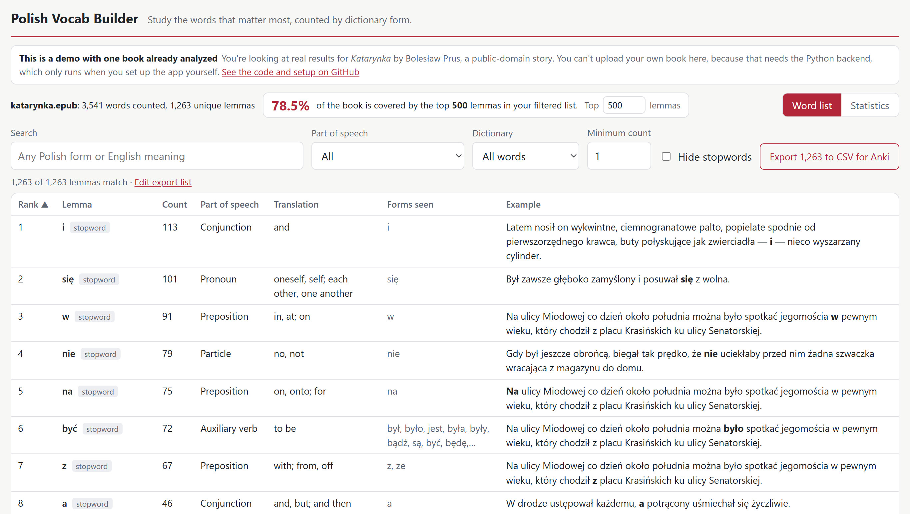
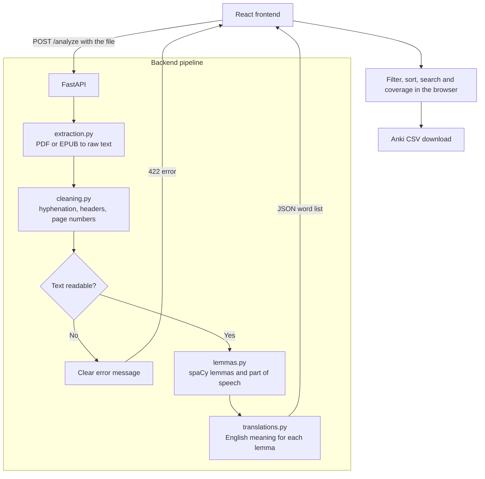

# Polish Vocab Builder

[](https://github.com/kylecooper3/polish-vocab-builder/actions/workflows/tests.yml)

Upload a Polish book as a PDF or EPUB and get a frequency list of its vocabulary, counted by dictionary form, so you can study the most useful words first. Each word comes with its English meaning, every form seen in the book, and an example sentence, and the list exports to Anki.

**[Try the live demo](https://kylecooper3.github.io/polish-vocab-builder/)**, which has one public-domain story already analyzed. You can filter, search and export, but uploading your own book needs the Python backend, so that only works when you [run the app yourself](#setup).



## Why lemmatization matters for Polish

Polish is heavily inflected: a word changes form depending on its role in the sentence. `mam`, `masz` and `ma` are all forms of `mieć` ("to have"), and irregular forms can look nothing like the dictionary word, such as `szedł` from `iść` ("to go").

Counting raw words would split one word into many entries and bury the words that matter. In *Lalka* by Bolesław Prus, `mieć` appears in **30 different forms**. Lemmatization reduces each form to its dictionary form, or *lemma*, so all 30 count as one word to learn.

It also makes the results useful for planning. In that novel (111,198 counted words):

| Most frequent lemmas | Share of the book's words |
|---|---|
| Top 100 | 48.8% |
| Top 500 | 69.4% |
| Top 1,000 | 77.8% |
| Top 5,000 | 94.7% |

## Features

- **Upload** a PDF or EPUB by drag and drop
- **Sortable, searchable table** of lemmas with rank, count, part of speech, English translation, forms seen and an example sentence
- **Search in either language**, by any Polish form or English meaning
- **Filters** for part of speech, minimum count, stopwords and whether a word is in the dictionary, which can surface words an author invented
- **Coverage stat**, such as "the top 500 lemmas cover 69.4% of the book"
- **CSV export** for Anki, with the word, translation and example sentence
- **Statistics view** showing how the book's words matched the dictionary, with a searchable list of every merge to check by hand

## Architecture



**Stack:** Python, FastAPI, spaCy (`pl_core_news_lg`), PyMuPDF, ebooklib, BeautifulSoup, React, Vite. Tests use pytest and run on every push with GitHub Actions.

## Setup

You'll need Python 3.15 (developed and tested on this version) and Node.js. Installing the backend downloads the 574 MB Polish language model. Everything runs locally and costs nothing.

### Backend

```bash
cd backend
python -m venv .venv
```

Then install the packages and start the server. On Windows:

```bash
.venv\Scripts\python.exe -m pip install -r requirements.txt
.venv\Scripts\python.exe -m uvicorn app.main:app --reload
```

On macOS or Linux:

```bash
.venv/bin/python -m pip install -r requirements.txt
.venv/bin/python -m uvicorn app.main:app --reload
```

Leave this terminal running. The backend has no page of its own, so you don't need to open its address. If you're curious, its API docs are at `http://127.0.0.1:8000/docs`.

### Frontend

In a second terminal:

```bash
cd frontend
npm install
npm run dev
```

On Windows, if PowerShell says running scripts is disabled, use `npm.cmd` in place of `npm`.

### Open the app

Keep both terminals running, then go to `http://localhost:5173` in your browser. That's the only address you need.

To try it, drag a Polish PDF or EPUB onto the upload box. If you don't have one, use the free story included in this project: the file `katarynka.epub` in the `sample` folder.

**About the addresses:** `localhost` and `127.0.0.1` both mean your own computer, so your copy of the app is only available to you. `5173` and `8000` are the default ports of Vite and Uvicorn, the programs that run the frontend and backend. The app expects those exact ports (they're set in `frontend/src/api.js` and `backend/app/main.py`), so if another program is using one, close it before starting the app.

### Tests

From the `backend` folder, using the same Python as above:

```bash
python -m pytest
```

## API

`POST /analyze` takes a file as `multipart/form-data`, plus an optional `exclude_stopwords=true` query parameter.

```json
{
  "total_tokens": 3541,
  "unique_lemmas": 1283,
  "lemmas": [
    {
      "lemma": "mecenas",
      "count": 33,
      "rank": 14,
      "pos": "NOUN",
      "translation": "patron, sponsor; lawyer, advocate",
      "forms": ["mecenas", "mecenasa", "mecenasem", "mecenasowi"],
      "example": "Gdy został mecenasem, czoło, skutkiem natężonej pracy umysłowej, urosło mu aż do ciemienia...",
      "example_spans": [[11, 20]],
      "is_stopword": false
    }
  ],
  "match_stats": {
    "in_dictionary": { "rows": 1194, "occurrences": 3410 },
    "merged": { "rows": 67, "occurrences": 77 },
    "unresolved": { "rows": 11, "occurrences": 12 },
    "no_match": { "rows": 37, "occurrences": 42 }
  },
  "merges": [
    {
      "from_lemma": "krążk",
      "to_lemma": "krążek",
      "count": 1,
      "pos": "NOUN",
      "forms": ["krążkiem"],
      "example": "Czerwona wiśnia stała się dla niej wiśnią gładką, okrągłą i miękką...",
      "example_spans": [[113, 121]],
      "method": "only_match",
      "new_row": true
    }
  ]
}
```

`example_spans` gives the start and end position of each use of the word in its example, measured in characters, so the page can bold exactly the words counted for that row.

`match_stats` puts every row spaCy produced into one group, before any merging. `merges` lists each row that was merged, biggest first. `method` is `only_match` when a form pointed to one word, or `tie_break` when the word already in the book was chosen. `new_row` means the book had no correct row for that word. Both describe the whole book, even with `exclude_stopwords=true`.

| Status | Meaning |
|---|---|
| 400 | The file is corrupt or password-protected |
| 413 | The file is over the 50 MB limit |
| 415 | The file isn't a PDF or EPUB |
| 422 | No readable text, such as a scanned book or a damaged text layer |

## Design decisions

**A separate module for each stage.** Extraction, cleaning and lemmatization each have one job, take plain data and return plain data. That means each can be tested without the others, and the web layer stays thin.

**Refuse damaged PDFs instead of guessing.** A PDF can look perfect on screen while its hidden text layer is wrong. In one real PDF, every `j` came out as the Telugu letter `గ`, and some spaces vanished, so `Inaczej świat` became `Inaczeగświat`. That can't be reliably repaired, and a confident list of fake words would be worse for a learner than an error. The app checks for this before running spaCy, so a bad file fails in about a second.

**Process long books in small pieces, one at a time.** spaCy's memory use grows with text size. Measured on a 780,000-character novel, 20,000-character chunks processed one at a time used 79 MB on top of the model, compared with about 2,600 MB for larger chunks at spaCy's default batch size, at about the same speed. Chunking alone wasn't enough, because spaCy's default batching groups the chunks back together.

**Clean up spaCy's output.** spaCy turns `myślałem` ("I thought") into `myśleć być`, because Polish past-tense endings behave like an attached form of "to be". The app keeps only the first word, so these count as `myśleć`. It also gives each lemma one stopword answer, since spaCy's list holds word forms and flags `mam` but not `masz`.

**Correct wrong verb lemmas with a dictionary.** spaCy sometimes invents a stem, turning `poszedłem` ("I went") into `poszedć`, or returns the word unchanged, as with `mógłbym` ("I could"). When a verb's lemma looks wrong in one of those ways, the app looks up the form in about 580,000 verb forms from Wiktionary, so these become `pójść` and `móc`. This changed 8% of the verbs in *Lalka* and removed about 1,000 false entries, for about 100 MB of extra memory. A form that could belong to two verbs is left alone rather than guessed.

**Check every other lemma against the dictionary too.** spaCy also invents noun and adjective stems, turning `krążkiem` into `krążk` when the word is `krążek`. A lemma missing from the dictionary is suspicious, so once the whole book is counted, the app looks up the form the book actually used in about 1 million forms from Wiktionary. If that gives one word, the rows merge. If it gives several, as with `meble` (`mebel` or `meble`), the app picks the one already in this book, and otherwise leaves the row alone. In *Lalka*, this merged 1,475 false rows, including 246 uses of `rubl` into `rubel`, and halved the blank rows from 2,846 to 1,371. A review of the merges found two wrong ones, `rocznie` ("annually") into `roczeń` ("yearling") and `bylem` into `byl` ("flower stalk"), which are now handled by hand. The cost is about 400 MB of extra peak memory.

**Split pronouns by gender and number.** spaCy files `on` ("he"), `ona` ("she"), `ono` ("it"), `oni` and `one` (both "they") under one lemma. That's a fair grammatical view, but it shows a learner "she" under "he". The app uses spaCy's gender and number tags to give each its own row, with forms like `go` under `on` and `ją` under `ona`. A sample of 30 uses per row from *Lalka* showed this works for `on` and `ona` (all 30 correct in each), but exposed a problem with `ono`: only 7 of 30 were right, because `jego` and `nim` are spelled the same for "he" and "it" and spaCy often guessed "it". So only `ono` and `je` count as "it" now, and those shared forms stay under `on`.

**Make the corrections checkable.** An automatic merge looks just as confident when it's wrong, so the Statistics view lists each one with its sentence and how it was decided. The list is read-only, because undoing merges would add a second way for results to change and nowhere to save it. The figures are recorded at the moment each decision is made rather than worked out again afterwards, so they show what the app actually did. A random sample of 200 merges from *Lalka*, judged by sentence, found none in the wrong word, 4 with a meaning that doesn't fit and 29 debatable groupings, mostly participles under their verb. That review wasn't done by a native speaker.

**Say "not in dictionary", not "invented".** The app can't tell a word an author made up from a rare real word or a spaCy mistake, because all three simply have no entry. So the filter describes what's actually known. Combining it with a minimum count helps, because a word an author coined and keeps using comes up repeatedly.

**Filter in the browser, not on the server.** Analyzing a novel takes about 30 seconds, while filtering takes a fraction of one. The API returns every lemma with its stopword flag, so filters respond straight away without re-analyzing the book.

**Measure coverage honestly.** Coverage is always a share of every counted word in the book. Hiding stopwords lowers the figure, from 69.4% to 26.2% for the top 500 in *Lalka*, rather than making it look better.

**Draw 200 table rows at a time.** A novel produces over 11,000 lemmas. Drawing them all made filter changes about 3.5 times slower, so the table draws 200 and offers "Show more", while search, filters and export still use the full list.

**A dictionary rather than machine translation.** A lone word has no context, so a translator has to guess, while a dictionary can show that `zamek` means both "lock" and "castle". English meanings come from Wiktionary, which is free, works offline and sends nothing to a third party. They cover 98% of the word occurrences in *Lalka*.

**Automatic rules, plus a small reviewed list for common words.** Rules handle over 145,000 words, but they get some common ones wrong. So about 180 hand-written fixes are applied on top, in [`translation_overrides.json`](backend/data/translation_overrides.json). The words to review were chosen from a frequency list of contemporary Polish rather than from one novel, which would skew toward its own vocabulary.

**A static demo instead of a hosted server.** The language model and word tables need a server with about 1.5 GB of memory, which isn't free to keep running everywhere. So the live demo is only the frontend on GitHub Pages, showing results saved ahead of time by the real pipeline. A test fails if those saved results stop matching the pipeline. The trade-off is that visitors can't upload their own book.

**Never store uploads.** Books are processed in memory and discarded, apart from a temporary file for EPUB parsing that's deleted straight away. `.gitignore` also blocks PDFs and EPUBs outside `sample/`, so copyrighted books can't be committed by accident.

## Limitations

- **Lemmatization isn't perfect.** spaCy's model makes mistakes, especially on rare words and older spelling. Characters' names are sometimes tagged as ordinary words, and ordinary words as names or verbs. Corrections only apply when a lemma looks wrong, so a wrong lemma that's a real word isn't caught, and most merges were checked by sampling rather than one by one. Hyphenated compounds are counted as two separate words.
- **The two words for "they" are often mixed up.** `ich`, `im`, `nich` and `nimi` are spelled the same for `oni` and `one`, so spaCy has to guess from context. In a sample from *Lalka*, 22 of 30 `oni` uses and 17 of 30 `one` uses were right. Both rows show "they", so the meaning is still correct, but their counts are only rough. "It" is undercounted, because neuter uses of `jego` and `nim` are counted under `on`. Possessives also stay with their pronoun, so `jego` ("his") appears under `on` ("he").
- **Words outside the dictionary can be split.** With no dictionary entry to merge into, one word can appear as several rows if spaCy gives its forms different lemmas, as with `fizjognomia` and `fizjognomii` in *Lalka*. An author's invented word could be split the same way. Invented names are excluded along with all other names, because spaCy can't tell `Trurl` from `Warszawa`.
- **Translations don't use context.** `mecenas` shows both "patron" and "lawyer", but only one applies in a given book. Each entry shows at most two meanings, so a less common one may be missing, and the example sentence is there to help. About 13% of a novel's distinct words have no translation, though they make up only 2% of its word occurrences.
- **Hand-written translations are unverified.** They haven't been reviewed by a native speaker.
- **Word meanings can be merged.** `wybory` is counted under `wybór` ("choice"), so its separate meaning of "elections" isn't shown.
- **PDF cleaning has only been tested at full length on a generated PDF.** It was checked by laying out a novel with headers, page numbers and hyphenation, then comparing the results to its EPUB. Real PDFs from other publishers may differ, and their footnotes will be counted as text.
- **Publisher material can be counted.** Footnotes, title pages and notices are removed for standard EPUB markup and for Wolne Lektury books, but other publishers' front and back matter will be included.
- **Scanned books aren't supported,** because they have no text layer and would need OCR.
- **Only the backend has automated tests.** The frontend was tested by hand in a browser.
- **Stopwords come from spaCy's list,** which includes some useful words, such as `pan` ("sir").
- **Language isn't detected.** An English book would produce a meaningless list rather than an error.

## Future ideas

- **Distinctive words:** compare a book's frequencies with Polish in general, to surface the words that are unusually common in this particular book
- **Known-words list:** hide words you've already learned, and show what coverage you'd reach by learning the next 100
- **Choosing the right meaning from context,** using word-sense disambiguation
- **OCR** for scanned books
- **A hosted backend** so anyone can upload a book, on a host such as Hugging Face Spaces that can fit the app's roughly 1.5 GB memory use
- **Frontend tests** for filtering, sorting and CSV export

## License

This project's code is licensed under the [GNU General Public License v3.0](LICENSE). The data below keeps its own license.

- **Sample book:** *Katarynka* by Bolesław Prus, public domain, from [Wolne Lektury](https://wolnelektury.pl/katalog/lektura/katarynka/). See [`sample/README.md`](sample/README.md).
- **Translations and verb forms:** derived from [English Wiktionary](https://en.wiktionary.org/) via [kaikki.org](https://kaikki.org/), under CC BY-SA 4.0. See [`backend/data/README.md`](backend/data/README.md).
- **Language model:** spaCy's `pl_core_news_lg` is GPL-3.0 licensed. It's downloaded during setup and isn't included in this repository.
